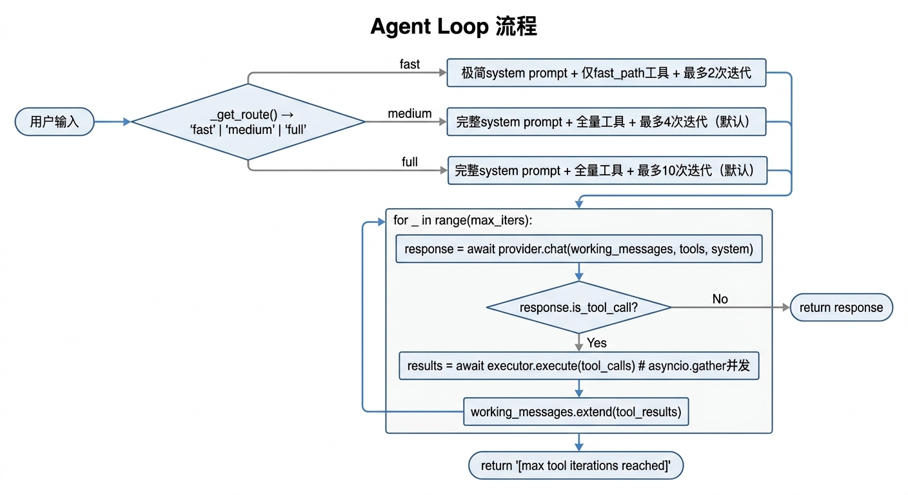
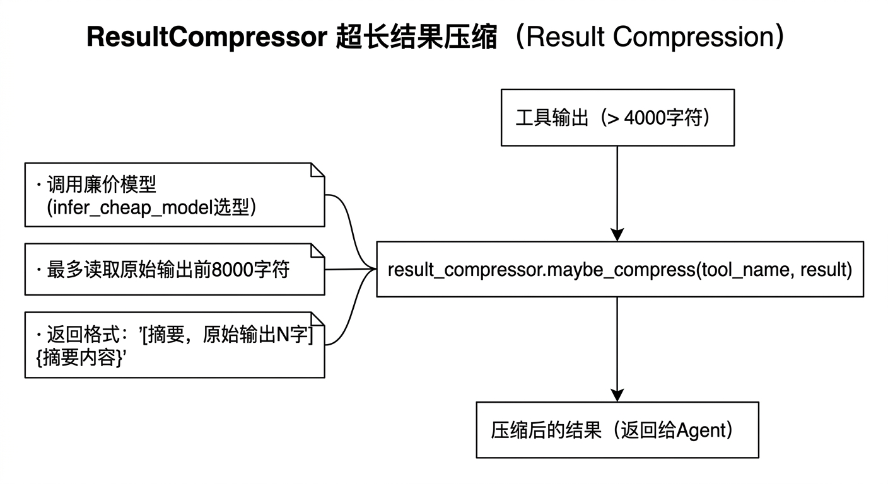

# Agent Loop 设计文档

当前 Agent Loop 融合了 ReAct 论文、OpenClaw 的分层结构和 nanobot 的极简风格，loop 本身保持精简，复杂性由 Provider / Tool / Memory / Skills 各子系统承担。

---

## 两种模式

| 方法 | 说明 |
|------|------|
| `Agent.chat(messages)` | 非流式，等待完整响应后返回 `Message` |
| `Agent.stream_chat(messages)` | 流式，逐 token yield 文本，tool call 前后推送 `ToolEvent` |

---

## Loop 流程

每次对话开始前，先由 `_get_route()` 决定走哪条轨道（见 [routing.md](routing.md)）：


<!-- diagram-source
```
用户输入
   │
   ▼
classify_instant() → 命中则零工具直答（算术/时间/打招呼），return
   │ 未命中
   ▼
_get_route() → 'fast' | 'full'
   │
   ├─ fast → 极简 system prompt + fast_base_tools + 规则声明的工具
   └─ full → 完整 system prompt + base_tools + find_tools 按需激活
   │
   ▼
迭代上限统一为 max_tool_iterations（不分档；stuck detection 才是真正兜底）
   │
   ▼
for i in range(max_iters):
    finalize = (i == max_iters - 1)        # 留最后一轮做收尾：禁工具、强制总结
    response = await provider.chat(working_messages, tools, system)
    if not response.is_tool_call → return response
    results = await executor.execute(response.tool_calls)  # asyncio.gather 并发
    working_messages.extend(tool_results)
    monitor.record(tool_calls, had_error)   # 卡死检测：记录本轮调用签名
    if monitor.is_stuck():
        if monitor.exhausted() → 禁工具收尾「已做/卡点/建议」并 return
        else → 注入反思 prompt（强制 <diagnosis> + 换路），下一轮生效

# 跑满迭代：最后一轮已禁工具、流式吐出收尾总结，不再吐死字符串
```
-->

> **卡死检测 + 优雅收尾**（`core/loop_control.py`）：主循环不再是裸 ReAct。
> `LoopMonitor` 记录每轮工具调用的签名（工具名 + 参数 JSON）；连续 3 轮同签名（或连续 2 轮同签名且都报错）判定「原地打转」，注入一条强制反思 system 提示（要求模型用 `<diagnosis>` 标签诊断根因并换路，禁止原样重试）。反思后仍重复则追加二次强提醒；最多反思 2 次仍卡住，则禁用工具、让模型生成「已完成 / 卡点 / 需用户提供」的收尾报告。跑满 `max_iters` 时同样留最后一轮禁工具收尾，而不是返回 `[max tool iterations reached]` 死字符串。chat / stream_chat 两条路径共用这套逻辑。
>
> 另有一条**频率熔断**：同一工具连续 N 轮、参数各异也会判卡住（`TOOL_FREQ_LIMIT_VARIED=6`，browser_* 放宽到 20）。但它对**只读分段读取**豁免——`file_read` 以及 `sed / awk / head / tail / cat / grep / jq` 等命令逐段读同一个大文件（review 大 diff、翻长日志）是正常推进，参数各异恰恰说明在读新内容；带写副作用的调用（`sed -i` / `sort -o` / `> out.txt` / awk `print >`）不豁免。精确重复（同签名 3 轮）与连续报错（2 轮）两条分支不受豁免影响，真在原地读同一段仍会停。若熔断收尾轮模型返回空内容，会依次走极简重试、再退到保底文案，**不会静默结束**。
>
> 真实 badcase（`s_20261112_1603_c3ca`）：review MR 时用 `sed -n 'a,bp'` 逐段读 diff 40 轮、42 次调用全部成功无报错，仍被 varied 频率熔断，且收尾轮空回复，用户侧表现为「对话莫名中断」。修复即上面的豁免 + 收尾兜底。

---

## 输入长度防护（`core/context_limit.py`）

`context_budget` 只管控 tool result 体积；user/assistant 正文与 system 不设防，会话长期累积后单次请求可能超过上游模型上下文硬限制（DashScope 系：`Range of input length should be [1, 997952]`，直接 400）。两层防护：

- **发送前预检**（proactive）：每次调 provider 前，`Agent._trim_input_if_needed()` 按字符估算全量输入（system + 全部消息 + tool_calls + 图片按每张固定值估算），超过 `effective_input_budget()`（上限 × 95%）就从最旧的轮次裁起。裁剪在 user 消息边界切割——不会出现孤儿 tool 消息或拆散 tool_call/tool 配对；裁剪后在列表开头插入 `[会话历史已截断：…]` 提示。只动 `working`（loop 的浅拷贝），session 持久化历史不受影响。
- **400 兜底**（reactive）：`is_input_length_error()` 识别各系上游的长度越界文案（DashScope / OpenAI `context_length_exceeded` / Anthropic `prompt is too long` 等），agent 层用减半预算再裁剪并重试一次（stream_chat 会先向用户 yield「会话过长，已自动截断…」提示）；system 本身超预算、裁不动时抛出用户可读的中文错误，不再透传 `provider_error` 原文。interface 层 `_friendly_error` 另有一道同款转译兜底。

阈值环境变量（env 赢过内置默认）：`ETHAN_MAX_INPUT_CHARS`（上游上限，默认 997952，设 0 关闭）、`ETHAN_INPUT_LIMIT_MARGIN_PCT`（安全余量 %，默认 5）。回归测试：`tests/test_context_limit.py`。

---

## 系统提示词构建（`_build_system`）

发布模板 `ethan/defaults/system/agent.md` 正文从 7,051 精简至 5,948 字符（低于 6,000 字符预算），合并重复路由与工具说明，完整保留危险操作分级、密钥访问限制和知识写入分流（含判断口诀与 lark-cli 示例）。此变更不覆盖 `~/.ethan/system/agent.md` 的用户定制；实际 `<agent_protocols>` 体积取决于运行时文件，以本地测量为准，不代表全量 prompt 降至 6,000 字符。

Full / Medium Path 按以下顺序拼接，`Current time:` 是稳定层与动态层的分界点（用于 Prompt Caching）。以 `ethan/core/system_prompt.py` 的 `build_system_prompt()` 为准：

```
─── 稳定层（可缓存，cache_control: ephemeral）───
<soul>                    ← system/soul.md（CRITICAL，最高优先级）
<identity>                ← system/identity.md
<persona_override>        ← 当前 mode 绑定 persona 时才注入
<mode_identity>           ← 当前 mode 声明 identity 时才注入
<agent_protocols>         ← system/agent.md
<tools_reference>         ← system/tools.md（全文，当前 34.3K 字符，最大单一来源）
<documents_protocol>      ← 产出文档的落盘约定
<image_protocol>          ← 仅当 OCR 工具已注册时注入
<available_skills>        ← 技能简表：default 类分级索引 + discoverable 触发词表，
                             合并为**一个**块（稳定层 + 动态层曾各拼一个同名块，已修复）
─── Current time: ───     ← 缓存分割线
─── 动态层（每轮变化，不缓存）───
workspace 路径 / Current model
<memory_recall_hint>      ← 仅 owner
<user_profile>            ← 用户画像
<behavioral_guidelines>   ← ProcedureStore（纠正准则 + 成功路径）
<relevant_skills>         ← 命中触发词的技能正文（按 query 变化，故在动态层）
<mode_setup>              ← mode 依赖技能未安装时才注入
<memory_signal>           ← 信号检测命中时注入 hint + 激活 memory_write
<runtime_context>         ← 渠道注入的会话上下文
<previous_run_summary>    ← 上一轮工具步骤摘要
```

> 体积实测：`python -m tests.bench_prompt_size`。当前 full 档 system prompt 约 51,954 字符
> （≈17.3K tokens），不含历史消息，也不含 API `tools` 参数里的工具 schema（广播 41 个
> 工具时约 12.4K tokens）。**工具循环每一次迭代都会把这两部分重新发送一遍**；
> Anthropic 的 prompt cache 只降低费用，不减少实际传输量或首 token 延迟。

Fast Path 保留：`soul + identity + persona/mode 覆盖 + agent_protocols + 时间/workspace/model +
文档协议 + 工具提示 + memory_recall_hint + user_profile + behavioral_guidelines +
匹配到的 Skill 简表/摘要`，约 13K 字符（≈4.4K tokens），不带 `tools_reference`、不带结构化记忆召回。

> `system/naming.md` **不进主 system prompt**：它只在生成会话标题时注入廉价模型的标题 prompt
> （见 `ethan/memory/session.py` 的 `_build_title_system_prompt`），零常驻 token 成本。
> 消息里出现 PR/MR 链接（`github.com/…/pull/<n>`、`gitlab.com/…/-/merge_requests/<n>`）这类确定性
> 场景走 `_rule_title` 直接短路（不调用模型）——链接在**任意位置**都算命中，不要求 `/review` 前缀；
> 模板的 owner/repo/编号由代码从链接里填，模型不需要也不能自己去猜。
> 同理，喂给标题模型前会把外链脱敏成 `[链接]`（避免 lite 模型以为要访问外链而拒答），
> **但 PR/MR 链接例外、原样保留**，否则模型拿不到值就只能照抄 naming.md 里的示例占位符。

---

## 工具执行（ToolExecutor）

### 轮次内去重缓存

同一轮 chat 内，相同工具 + 相同参数的调用结果会被缓存，避免重复执行。

```python
# 缓存键：tool_name + args_hash（MD5）
cache_key = f"{tc.name}:{hashlib.md5(json.dumps(tc.arguments, sort_keys=True)).hexdigest()}"
```

每次新的 `chat()` / `stream_chat()` 开始时调用 `executor.reset_cache()` 清空缓存，确保不同轮次之间互不干扰。

### 并发执行

LLM 有时在一次回复中请求多个 tool，`asyncio.gather()` 并发执行可显著减少延迟。

### 超长结果压缩（ResultCompressor）

工具结果超过 **4000 字符**时，`ToolExecutor` 自动调用 `maybe_compress()`，用廉价模型将原始输出提炼为不超过 **1200 字**的摘要，再喂给主模型。


<!-- diagram-source
```
工具输出 (>4000 字符)
    │
    ▼
result_compressor.maybe_compress(tool_name, result)
    │
    ├─ 调用廉价模型（infer_cheap_model 选型）
    ├─ 最多读取原始输出前 8000 字符
    └─ 返回 "[摘要，原始输出 N 字]\n{摘要内容}"
```
-->

压缩失败时退化为截断（保留前 4000 字符）。

---

## 消息格式

整个 loop 维护 `working_messages` 列表，格式同时兼容 Anthropic 和 OpenAI 协议（各 Provider 负责自己的转换）：

```
[user]       "帮我查一下当前时间"
[assistant]  tool_calls: [shell(command="date")]
[tool]       "Wed Jun 11 13:49:00 CST 2026"
[assistant]  "当前时间是 2026年6月11日 下午1点49分"  ← 最终返回
```

---

## 设计决策

**分档路由**：instant / fast / full 兼顾延迟与推理深度（详见 [routing.md](routing.md)）。早期的 `medium` 中轨已移除——它按字数分档，而字数与任务复杂度不相关；迭代上限改为统一由 `max_tool_iterations` 控制，真正的兜底是 stuck detection 而非分档限次。

**并发 tool calls**：LLM 有时在一次回复中请求多个 tool，`asyncio.gather()` 并发执行可以显著减少延迟。

**轮次内工具缓存**：相同工具+参数在同一轮不重复执行，防止 LLM 循环调用相同工具浪费资源。

**超长输出压缩**：shell 或 web 工具有时返回数万字符，不经处理直接塞回主模型既昂贵又低效，廉价模型先摘要再注入。

**max_iterations 上限**：防止 LLM 陷入 tool call 死循环（工具持续报错时）。Fast 固定为 2，Medium 默认 4，Full 默认 10，可通过 config 调整。跑满上限不再吐死字符串，而是留最后一轮禁用工具、让模型收尾总结（见上文「卡死检测 + 优雅收尾」）。

**卡死检测优于纯靠迭代上限**：迭代上限只是兜底——它要等跑满所有轮次才止损，期间用户干等、token 照烧。`LoopMonitor` 在连续 3 轮（或 2 轮同错误）原地打转时就主动介入注入反思，让模型显式诊断换路，比被动等上限更省也更可控。签名按「工具名 + 全量参数」比对——递增分页（offset 变化）会产生不同签名，天然不被误判为卡住。

**UsageStats**：`cache_tokens` 同时统计 `cache_read` 和 `cache_creation`，确保状态栏显示的缓存命中数准确。

---

## 真实 wire 历史

逐轮 assistant reasoning、tool-call ID 与结果独立于 UI 汇总正文保存，下一请求恢复完整配对。
消息与 wire 独立事务同时提交；详见 [协议持久化](wire-transcripts.md)。这不替代每轮运行检查点。

### DeepSeek 历史回传与离线 HTTP 契约

[官方 Thinking Mode](https://api-docs.deepseek.com/guides/thinking_mode/) 要求携带 `tools` 时完整回传所有历史轮的真实 `reasoning_content`，包括没有调用工具的 assistant 轮；没有要求每轮返回非空 reasoning。
精确主机 `api.deepseek.com` 与当前官方型号 `deepseek-flash` / `deepseek-v4-pro` 的带工具请求因此保留任何历史轮已返回的 reasoning，不因最近一轮为空而丢弃较早历史。不生成空轮的假 reasoning；其他主机或型号仍使用旧的最近 assistant 判定，不默认给未知网关新增透传，也不改变 thinking 开关。

`tests/test_reasoning_http_contract.py` 使用真实 OpenAI SDK、仅本次 `127.0.0.1:0` 随机端口允许的 HTTP transport、合成 JSON/SSE 与临时 SQLite：实际 producer 保存后关闭重开，新的 Agent/provider 通过 chat 和 stream 发出下一请求，服务端检查两工具轮及无工具最终轮的 Unicode/空白原文与 call-id 配对；另覆盖空第二工具轮/空最终轮。丢弃、交换、截断 reasoning 的对照必须收到真实 HTTP 400，不允许 SDK/连接重试或模型 fallback，每个 fixture 最多八请求。
这是 Ethan→SQLite→SDK→本地 HTTP 的离线协议证据，不经过 Buddy/Trae，不产生模型账单，**不证明 DeepSeek 官方线上通过或当前网关上游原文透传**。现有网关真实探针 236→0→0 的结果与未通过的严格非空覆盖要求仍保留，不能以此本地测试替代线上验收。

## 模块拆分

`core/agent.py` 长期承担了循环控制 + 回复质量判定 + 错误分类三件事。按职责把与 `Agent` 实例状态无关的纯函数拆到独立模块，`agent.py` 保留 re-export 以兼容旧引用路径（`agent._is_degenerate_reply` 等）：

| 模块 | 职责 |
|------|------|
| `core/agent.py` | 兼容门面：Agent 公共接口、路由、prompt/provider 辅助与旧 re-export |
| `core/agent_loop.py` | 唯一七步编排：注入、生成、响应判定、工具、监控、补偿、预算 |
| `core/agent_loop_state.py` | 单次请求状态、决策与动态注入 |
| `core/agent_generation.py` | Chat/StreamTransport：生成、重试、首字和流事件政策 |
| `core/agent_tool_phase.py` | StreamToolPhase：授权、特殊交互、工具事件与执行 |
| `core/reply_quality.py` | 错误归类（图片 400 / 可重试连接错误）、空回复兜底文案、退化回复判定、合成 user 消息前缀识别、图片剥离重试 |
| `core/loop_control.py` | `LoopMonitor`（卡住检测）、反思/决策/失败提醒文案、收尾指令 |
| `core/stream_collector.py` | 统一流消费器：tool_steps 计时、正文/reasoning 累积、已输出去重 |

循环控制流已从 Agent 提取为 request-owned `LoopState`，公共方法仍分别选择传输政策，
不是 `chat → stream_chat + join`。Chat 返回最后的原始 Message、保留其 usage/reasoning/images，
无新增 instant 分支；Stream 保留工具授权、等待交互、主 provider 辅助收尾和有界网络重试。
历史差异不在结构 PR 中偷改。兼容门面保留 module monkeypatch seam、`Agent.__new__` 和旧引用路径。

六个核心/测试文件分别为 530/230/112/180/293/319 行，均 ≤700。
先在旧实现跑 17 项 characterization，再将同一公开行为套件扩到 24 项，旧、新两边均通过；
纯重构相关 168 项回归通过。此 PR 不包含持久检查点、wire 历史恢复、首轮记忆或分级路由功能。

