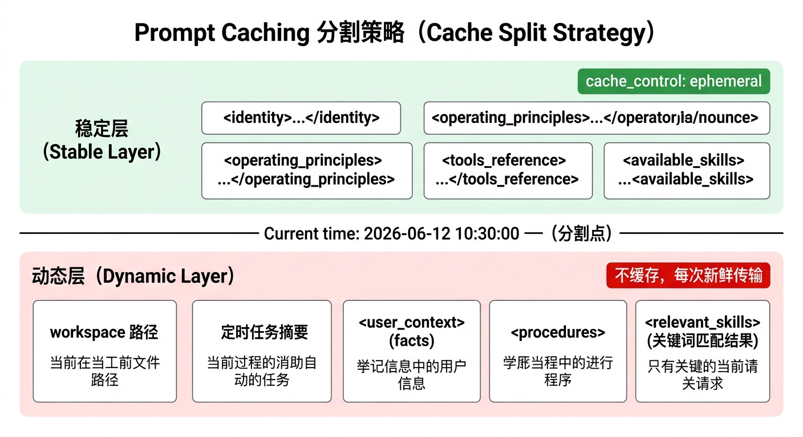

# Prompt Caching 设计文档

Anthropic Provider 对 system prompt 进行稳定层/动态层分割，利用 Claude 的 Prompt Caching 功能降低高频调用的 token 成本。

---

## 核心思路

system prompt 中有大量内容在多轮对话间几乎不变（identity、soul、tools_reference、available_skills），每次调用都重新传输和计费是浪费。Anthropic 的 Prompt Caching 允许将内容块打上 `cache_control: ephemeral` 标记，5 分钟内重复使用时只需支付 **0.1× 的 input token 费用**（写入缓存时收 1.25× 一次，后续命中均为 0.1×）。

---

## 分割策略

文件：`ethan/providers/anthropic.py`，函数 `_split_system_for_cache()`

分割点：`Current time:` 字符串。


<!-- diagram-source
```
[稳定层]                         ← 打 cache_control: ephemeral
<soul>...</soul>
<identity>...</identity>
<persona_override> / <mode_identity>（按 mode 可选）
<agent_protocols>...</agent_protocols>
<tools_reference>...</tools_reference>       ← 当前 34.3K 字符，最大单一来源
<documents_protocol> / <image_protocol>（按条件）
<available_skills>...</available_skills>     ← 技能简表，合并为单个块

─── Current time: 2026-06-12 10:30:00 ───  ← 分割点

[动态层]                         ← 不缓存，每次新鲜传输
workspace 路径 / Current model
<memory_recall_hint>（仅 owner）
<user_profile>
<behavioral_guidelines>（procedures）
<relevant_skills>（关键词匹配结果，按 query 变化）
<runtime_context> / <previous_run_summary>（按条件）
```
-->

稳定层内容由 `system/soul.md`、`system/identity.md`、`system/agent.md`、`system/tools.md` 和技能简表组成，这些文件在服务运行期间几乎不变，缓存命中率极高。技能简表（`<available_skills>`）是**一个**块：曾同时在稳定层和动态层各拼一个同名块，已合并；现在整体位于稳定层。

动态层包含当前时间、用户画像、纠正准则和 Skill 匹配结果，每轮都会变化，不适合缓存。

**注意**：缓存降低的是**费用**（命中时按 0.1× input 计费），并不减少每次请求实际传输的 token 数、不释放上下文窗口、也不缩短首 token 延迟。当前 full 档单次调用的固定开销约 29.7K tokens（system 17.3K + 41 个广播工具的 schema 12.4K，均不含历史消息），且在工具循环的每次迭代里重复发送。真正的体积优化只能靠减少注入内容（见 `ETHAN_V2_RESTRUCTURE_PLAN.md` P1）。

---

## 实现细节

```python
def _build_system_blocks(system: str) -> list[dict]:
    stable, dynamic = _split_system_for_cache(system)
    blocks = []
    if stable:
        blocks.append({
            "type": "text",
            "text": stable,
            "cache_control": {"type": "ephemeral"},
        })
    if dynamic:
        blocks.append({"type": "text", "text": dynamic})
    return blocks
```

这个函数在 `chat()` 和 `stream_chat()` 中均被调用，两种模式下行为一致。

---

## Cache Token 统计

`UsageStats.add()` 同时累计两种缓存 token：

```python
self.cache_tokens += (
    usage.get("cache", 0)
    + usage.get("cache_read", 0)       # 命中缓存，读取计费
    + usage.get("cache_creation", 0)   # 首次写入缓存计费
)
```

CLI 状态栏显示的 `⚡N` 即为此值，代表本次会话累计缓存涉及的 token 总量。

---

## 与双轨推理的协同

两条轨道都能命中缓存，但方式略有不同：

- **Fast Path**：system prompt 极简（identity + Current time + top-5 facts + Skill），稳定层更短，缓存的绝对体量较小，但命中率同样高
- **Full Path**：稳定层包含完整的 identity/soul/tools_reference 和全部 Skill 列表，缓存的 token 量更大，节省更显著

在 `ethan serve` 长期运行场景下，同一 identity.md 内容会在所有请求之间复用，稳定层缓存的节省效果随调用频率线性累积。

---

## 成本估算示例

假设稳定层 = 2000 token，每小时调用 30 次：

| 场景 | 稳定层费用/小时 | 说明 |
|------|----------------|------|
| 无缓存 | 2000 × 30 × 单价 | 每次全量计费 |
| 有缓存 | (2000 × 1.25 + 2000 × 0.1 × 29) × 单价 | 首次写入 1.25×，后续 0.1× |
| 节省比例 | ~86% | 高频调用下节省显著 |

实际节省取决于 5 分钟内的调用密度（缓存有效期 5 分钟，超时后重新写入）。

---

## 局限性

- 仅 Anthropic Provider 支持（`anthropic.py`）。OpenAI 兼容协议走的是不同路径，目前不做缓存分割。
- 缓存有效期为 5 分钟（Anthropic 规格）。长时间空闲后的第一次调用会重新写入缓存，成本稍高。
- `system/identity.md` 内容变化（如修改 system prompt）会使缓存失效，下一次调用重新写入。
